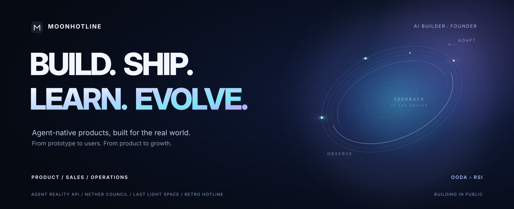

<!-- Personal profile README: factual project descriptions; goals are explicitly goals. -->

  

<h1 align="center">AI Builder. Founder mindset. Real users first.</h1>

  <strong>Building agent-native products, learning from the real world.</strong> 
  从产品开发到用户获取、销售与运营，让 AI 项目真正有人使用。

  <a href="https://ghost.oodai.space/">Nether Council</a> ·
  <a href="https://retro.oodai.space/">Retro Hotline</a> ·
  <a href="https://last-light-space.vercel.app/">Last Light Space</a> ·
  <a href="https://github.com/moonhotline/Agent-Reality-API">Agent Reality API</a>

---

## What I do / 我在做什么

I'm **Moonhotline**, an independent AI builder with a founder's approach to **product, distribution, sales, and operations**. I build fast, but shipping code is only the start: a useful product needs real users, evidence that it works, and a repeatable feedback loop.

我关注的不只是 AI Coding，而是 **从 0 到 1 的完整创业闭环**：发现真实问题、快速构建 MVP、获得首批用户、验证价值、持续运营并迭代。

**North star:** Get the first **10 real users** for a product, observe what they actually do, then earn the next 100. This is a goal—not a claim of current users, sales, or revenue.

## Selected builds / 代表项目

**[Agent Reality API](https://github.com/moonhotline/Agent-Reality-API)** — External DNS / TLS / HTTP observation, acceptance checks, and scoped evidence for coding agents. REST + MCP. [Explore the source](https://github.com/moonhotline/Agent-Reality-API)

**[Nether Council · 黄泉议会](https://github.com/NeutrinoGroup/Nether-Council)** — A browser-based, Halloween-themed AI character experience focused on real-time duplex voice, interruptions, bilingual interaction, and shareable identities. [Enter the Council](https://ghost.oodai.space/)

**[Last Light Space · 余晖](https://github.com/moonhotline/last-light-space)** — A cooperative 3D browser expedition exploring real-time multiplayer, physics, and authored sci-fi worlds. Multiplayer availability depends on its separately hosted room service. [Explore](https://last-light-space.vercel.app/)

**[Retro Hotline](https://github.com/moonhotline/retro-hotline)** — A neon, single-player 3D browser FPS built around movement, wave survival, and a procedural soundtrack. [Play in browser](https://retro.oodai.space/)

Other experiments: [Synro](https://github.com/moonhotline/synro) (chat and collaboration interface) · [Accompany](https://github.com/moonhotline/accompany) (voice companion MVP; some integrations are demonstrative).

Project sites and prototypes are experimental. Check each repository for current implementation details, limitations, and deployment requirements.

## My operating system / 我的行动框架

**OODA — Observe → Orient → Decide → Act.** Shorten the distance between reality and the next product decision.

**RSI — Recursive Self-Improvement.** Make the *building and learning process* better every cycle: clearer requirements, reusable components, stronger agents, more reliable verification, and better distribution. A working philosophy, not a claim that these apps autonomously rewrite themselves.

**Product → Sales → Operations → Feedback.** Build something useful; reach actual users; understand conversion and retention; improve the experience; repeat.

I care about **agent-native applications**, tool-using agents, practical verification, real-time AI interaction, and shipping products that people choose to come back to.

## Build in public / 一起验证

**Action first. Ship the imperfect first version. Verify it in reality. Improve from evidence.**

If you try a project, feedback is more valuable than a vanity metric. Open an issue in its repository with what worked, what broke, and what would make you return.

[Explore all public repositories](https://github.com/moonhotline?tab=repositories) · [Report feedback for Agent Reality API](https://github.com/moonhotline/Agent-Reality-API/issues/new) · [Give feedback on Nether Council](https://github.com/NeutrinoGroup/Nether-Council/issues/new)
